# ePizzaHub-StoredProcedures

# ePizzaHub (Stored Procedure Edition)

An online pizza ordering application built with **ASP.NET Core 8 (Web API + MVC)**, **Dapper** and **SQL Server stored procedures**.
Browse items, build a cart as a guest, log in, check out and pay through **Razorpay** (test mode).

This is a rebuild of an earlier EF Core, code-first version. The goal of this version: keep the data rules
(price validation, ownership checks, transactions, locking) in SQL Server, and keep the C# layers thin and testable.

## Tech stack

| Area | Choice |
|---|---|
| API | ASP.NET Core 8 Web API |
| UI | ASP.NET Core 8 MVC (Razor views, jQuery) |
| Data access | Dapper + stored procedures (`Microsoft.Data.SqlClient`) |
| Database | SQL Server |
| Auth | JWT (HS256) for the API, cookie auth for the MVC UI |
| Passwords | BCrypt (`BCrypt.Net-Next`) |
| Payments | Razorpay (REST API, test mode) |
| Logging | Serilog (console + rolling file) |
| Tests | xUnit + Moq |

## Architecture

```
Browser
  |
ePizzaHub.UI (MVC)  -- HttpClient + JWT (HttpOnly cookie) -->  ePizzaHub.API
                                                                  |
                          Middleware (exception handler, logging, https, authN, authZ)
                                                                  |
                                                  Controller  (HTTP, identity from token)
                                                                  |
                                           ePizzaHub.Core  (Services: business rules)
                                                                  |
                                      ePizzaHub.Repositories  (Dapper, SP calls only)
                                                                  |
                                              SQL Server  (stored procedures)
```

| Project | Responsibility |
|---|---|
| `ePizzaHub.API` | Controllers, middleware, JWT, Razorpay gateway, DI composition root |
| `ePizzaHub.Core` | Services, business rules, settings, payment signature helper |
| `ePizzaHub.Repositories` | Repositories (Dapper), DB connection factory |
| `ePizzaHub.Models` | Request/response DTOs |
| `ePizzaHub.UI` | MVC front end |
| `ePizzaHub.Tests` | Unit tests for the service layer |

Patterns used: Layered architecture, Repository, Service layer, DTO, Dependency Injection, Factory (connection factory),
Adapter (`RazorpayGateway` behind `IPaymentGateway`), Options pattern, Chain of Responsibility (middleware, `DelegatingHandler`).

## Stored procedures

| Module | Procedure | Notes |
|---|---|---|
| User | `usp_User_Create` | Duplicate-email check, assigns the "User" role, returns new id (OUTPUT) |
| User | `usp_User_GetByEmail` | Two result sets: user and roles |
| Item | `usp_Item_GetAll` | |
| Cart | `usp_Cart_AddItem` | Price read from `Items`, get-or-create cart, upsert line with `UPDLOCK, HOLDLOCK` |
| Cart | `usp_Cart_GetDetails` | Two result sets: header with total, lines |
| Cart | `usp_Cart_GetItemCount` | |
| Cart | `usp_Cart_UpdateItemQuantity` | |
| Cart | `usp_Cart_RemoveItem` | |
| Cart | `usp_Cart_UpdateUser` | Links a guest cart to the logged-in user |
| Payment | `usp_Payment_Make` | One transaction: payment, order, order items, close cart. Idempotent. Recomputes totals from the cart |
| Order | `usp_Order_GetByUser` | Two result sets: orders, lines |

Business errors are raised with `THROW` using fixed numbers, and mapped to HTTP status codes in one place
(`GlobalExceptionHandler`):

| SQL error | Meaning | HTTP |
|---|---|---|
| 50001 | Email already registered | 409 |
| 50010 | Invalid quantity | 400 |
| 50011 | Item not found | 404 |
| 50012 | Cart is no longer active | 409 |
| 50013 / 50014 | Cart / cart item not found | 404 |
| 50020 | Active cart not found for this user | 404 |
| 50021 | Cart is empty | 400 |
| 50022 | Paid amount does not match cart total | 422 |
| 2601 / 2627 | Unique constraint violation | 409 |

## Security and data-integrity decisions

- **Price is never taken from the client.** The cart procedure reads it from `Items`; checkout recomputes totals from the cart.
- **Identity comes from the JWT**, never from the request body (prevents IDOR). Cart ownership is re-checked inside `usp_Payment_Make`.
- **Login is a POST** and returns the same message for unknown email and wrong password (no user enumeration).
- **Passwords** are hashed with BCrypt in C#; the database only stores the hash.
- **Payment verification (3 layers):** Razorpay HMAC-SHA256 signature (constant-time compare), the real amount and status are
  fetched from Razorpay server-to-server, and the stored procedure matches the amount with the server-side cart total.
- **Idempotent checkout:** the same payment id never creates a second order.
- **Atomic checkout:** `SET XACT_ABORT ON` and a single transaction; any failure rolls everything back.
- **Concurrency:** `UPDLOCK, HOLDLOCK` on cart upsert, plus a `UNIQUE (CartId, ItemId)` index as the last line of defense.
- **Secrets** (connection string, JWT secret, Razorpay keys) live in user-secrets / environment variables, not in the repo.
- **Errors:** internal exception details are logged, and never returned to the client (`ProblemDetails`, generic 500/502).

## API overview

| Method | Route | Auth | Purpose |
|---|---|---|---|
| POST | `/api/User` | No | Register |
| POST | `/api/Auth/login` | No | Login, returns JWT |
| GET | `/api/Auth/me` | Yes | Show token claims (diagnostics) |
| GET | `/api/Item` | No | List items |
| POST | `/api/Cart/add-item-to-cart` | Optional | Add item (guest or logged in) |
| GET | `/api/Cart/get-cart-details` | No | Cart with tax and grand total |
| GET | `/api/Cart/get-item-count` | No | Number of lines in the cart |
| PUT | `/api/Cart/update-item` | No | Change quantity |
| DELETE | `/api/Cart/delete-item` | No | Remove a line |
| PUT | `/api/Cart/update-cart-user` | Yes | Attach cart to the logged-in user |
| POST | `/api/Payment/create-order` | Yes | Create the Razorpay order (amount in paise, from the cart) |
| POST | `/api/Payment` | Yes | Verify the payment and create the order |
| GET | `/api/Order` | Yes | Order history of the logged-in user |

## Getting started

### Prerequisites
- .NET 8 SDK
- SQL Server (Express is fine) and SSMS
- A Razorpay account (test mode keys, `rzp_test_...`)

### 1. Database
1. Create a database, for example `ePizzaHub_SP`.
2. Run the scripts in `Database/` in order (schema and seed data first, then the stored procedures).

### 2. API configuration (user-secrets)
```bash
cd ePizzaHub.API
dotnet user-secrets init
dotnet user-secrets set "ConnectionStrings:Default" "Server=localhost\SQLEXPRESS;Database=ePizzaHub_SP;Trusted_Connection=True;TrustServerCertificate=True"
dotnet user-secrets set "Jwt:Secret" "<random string, at least 32 characters>"
dotnet user-secrets set "Razorpay:KeyId" "rzp_test_xxxxxxxx"
dotnet user-secrets set "Razorpay:KeySecret" "<your test key secret>"
```
Generate a JWT secret (PowerShell):
```powershell
$b = New-Object byte[] 48; [Security.Cryptography.RandomNumberGenerator]::Create().GetBytes($b); [Convert]::ToBase64String($b)
```
Other settings (`Jwt:Issuer`, `Jwt:Audience`, `Pricing:TaxRate`, Serilog) are in `appsettings.json`.

### 3. UI configuration
Set `EPizzaAPI:Url` in `ePizzaHub.UI/appsettings.Development.json` to your API address, for example `https://localhost:7218/api/`.

### 4. Run
Start both `ePizzaHub.API` and `ePizzaHub.UI` (in Visual Studio: Configure Startup Projects, Multiple startup projects).
Swagger is available at `/swagger` on the API.

### 5. Test payment
Use Razorpay test mode: card `4111 1111 1111 1111` with any future expiry and CVV, or UPI `success@razorpay`.

### 6. Tests
```bash
dotnet test
```

## What the tests cover
Service-layer unit tests with Moq: password hashing and verification, email normalization, tax and rounding rules,
payment signature validation, "amount and status come from the gateway, not the client", and cart ownership checks.
Stored procedure behavior is verified with the SQL scripts in `Database/tests/`.

## Known limitations and next steps
- Add refresh tokens (access token currently expires in 60 minutes)
- Add rate limiting on the login endpoint
- Add a Razorpay webhook so a payment is confirmed even if the browser is closed
- Add a reconciliation job for payments captured but not saved (currently logged as critical)
- Add integration tests for the stored procedures
- Add role-based admin endpoints (`[Authorize(Roles = "Admin")]`)
- Add caching and paging for the item list

## Screenshots
_Add screenshots here: dashboard, cart, Razorpay checkout, receipt, Swagger._

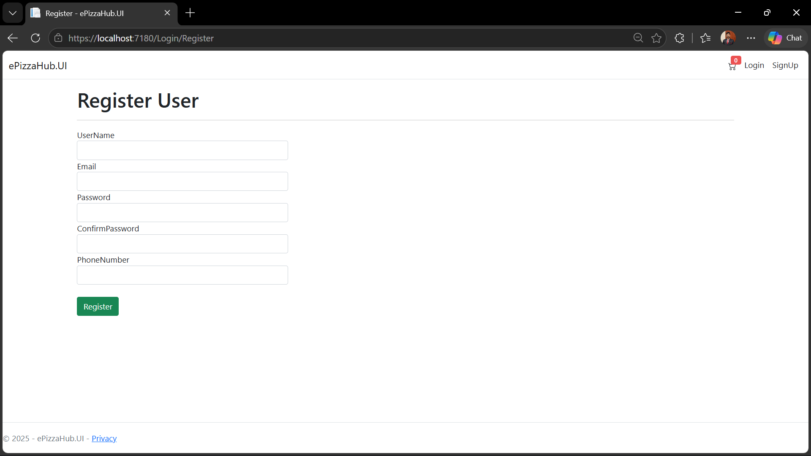
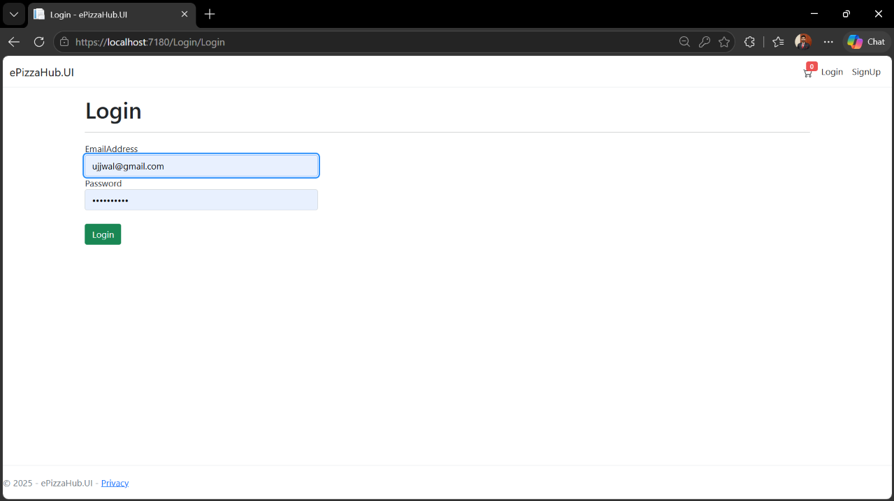
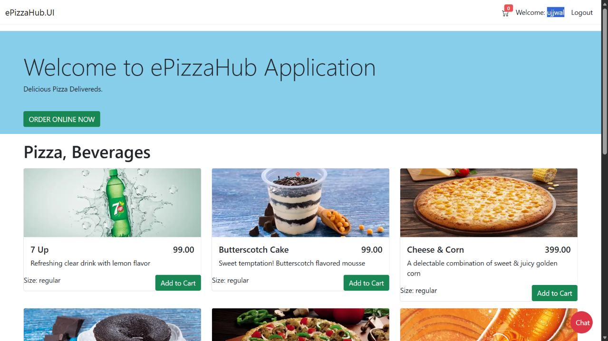
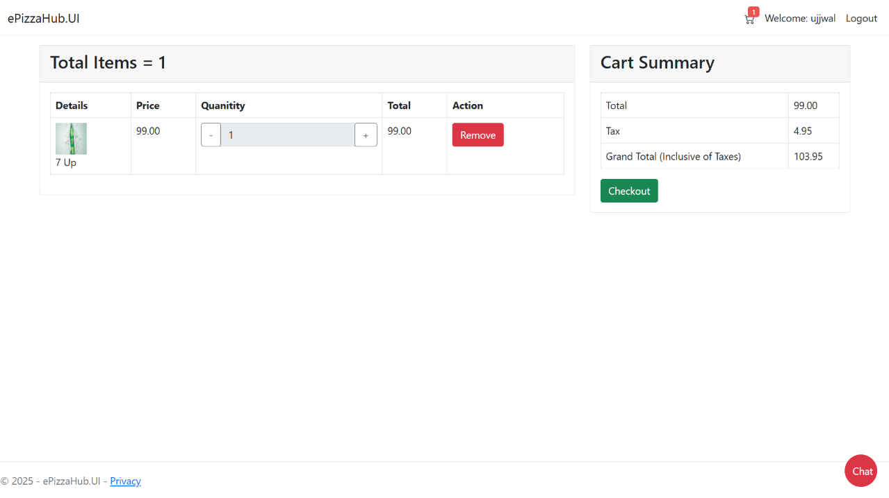
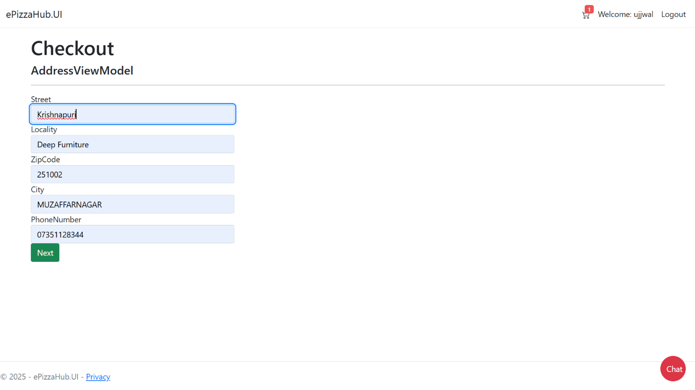
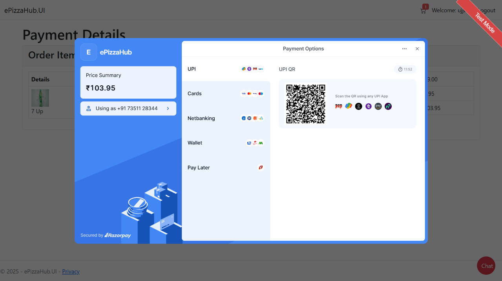
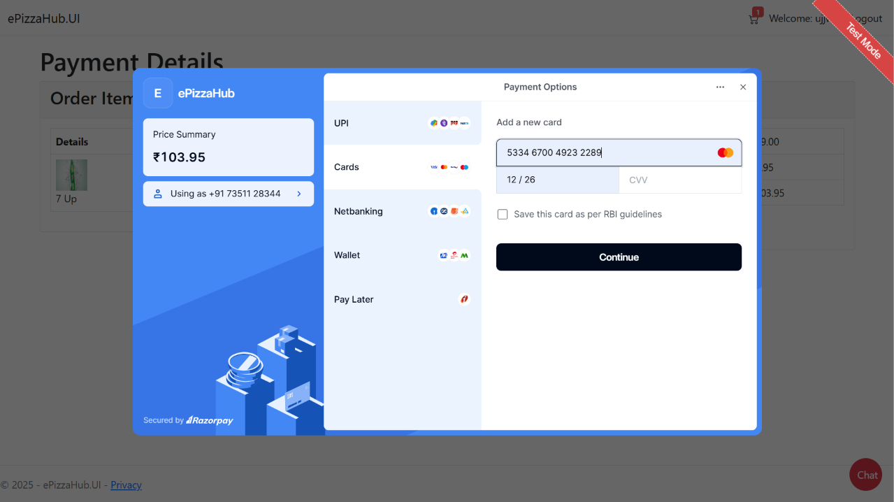


## AI assistant (MCP + agentic AI, runs locally)

A chat assistant inside the MVC UI. A logged-in user can ask for the menu, add or remove pizzas in the cart and see their orders. The language model runs locally through Ollama, and it reaches the application only through an MCP (Model Context Protocol) server that exposes a small set of tools.

# How it works
Browser (chat widget, JWT cookie + CSRF token)
  |  POST /Assistant/Chat
ePizzaHub.UI  (AssistantController: reads the CartId cookie, calls the API with the user's JWT)
  |  POST /api/Assistant/chat   [Authorize, rate limited]
ePizzaHub.API (AssistantService = agent loop + MCP client)
  |        \__ LLM (Ollama, qwen2.5:7b) decides which tool to call
  |  MCP over Streamable HTTP  (headers: Authorization, X-Cart-Id)
ePizzaHub.Mcp (MCP server, /mcp, 5 tools)
  |  HTTP with the same JWT
ePizzaHub.API (existing controllers: validation, ownership checks, services)
  |
SQL Server (stored procedures)

The agent loop is the function-invocation middleware of Microsoft.Extensions.AI: the model asks for a tool, the tool runs through MCP, the result goes back to the model, and this repeats until the model gives a final answer (maximum 5 iterations).

# Tools exposed by the MCP server
# Tool	Type	Notes
search_menu	read-only	Lists menu items, optional text filter
get_cart	read-only	Cart lines, tax and grand total
get_my_orders	read-only	Orders of the logged-in user (identity from the JWT)
add_to_cart	write	Quantity 1-10 enforced on the server
remove_from_cart	write	Only removes from the caller's own cart

There is deliberately no checkout or payment tool. Checkout stays a human action in the UI (Razorpay flow).

Security decisions for the assistant
Identity never comes from the model. The user's JWT and the cart id travel as transport headers (Authorization, X-Cart-Id). No tool has a user-id or cart-id argument, so the model cannot ask for another user's data.
Least privilege. The worst a misled model can do is change the caller's own cart. It cannot place orders, pay or change prices.
The MCP server calls the existing API, not the database. Validation, ownership checks and stored procedures are not bypassed.
Server-side limits, not prompt rules: quantity 1-10, message length 500, one running chat per user (concurrency limiter, HTTP 429).
Prompt injection: the system prompt says tool output is data, not instructions, but the real protection is the tool design above. Tested with direct attacks and with an indirect attack (instructions hidden in a menu description).
Output is untrusted: the chat widget renders replies with textContent (no XSS). The chat endpoint requires login and an anti-forgery token.
Run it
Install Ollama and pull the model: ollama pull qwen2.5:7b
Settings (ePizzaHub.API/appsettings.json):
json
   "Assistant": { "OllamaUrl": "http://localhost:11434", "Model": "qwen2.5:7b",
                  "McpUrl": "http://localhost:5200/mcp", "MaxIterations": 5 }

and in ePizzaHub.Mcp/appsettings.json: "EPizzaAPI": { "Url": "https://localhost:7218/api/" } 3. Start in this order: Ollama, ePizzaHub.API, then the MCP server dotnet run --project ePizzaHub.Mcp --urls http://localhost:5200, then ePizzaHub.UI. 4. Log in and use the chat button at the bottom right.

To inspect the tools without the UI: npx @modelcontextprotocol/inspector (Streamable HTTP, http://localhost:5200/mcp).

Known limitations of the assistant
On a CPU-only machine a reply takes about 1 to 1.5 minutes (the UI shows a timer). A GPU, a smaller model or a hosted model is faster.
Each message is independent (no conversation memory yet).
Replies are not streamed.
Small local models can pick the wrong tool or ignore instructions, which is why the limits live in code.

## Screenshots

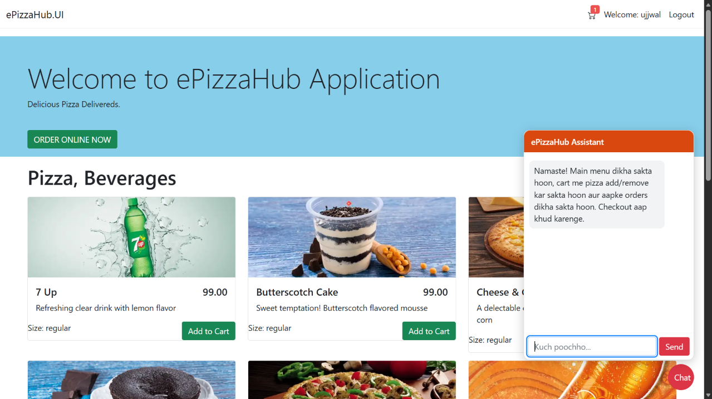
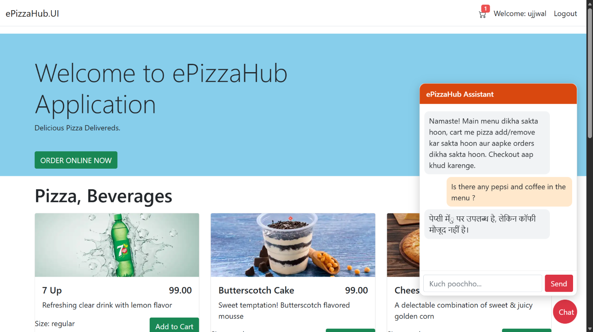
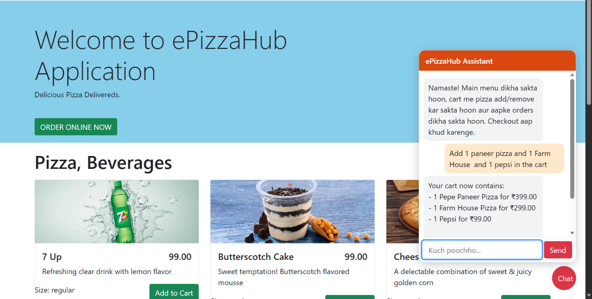
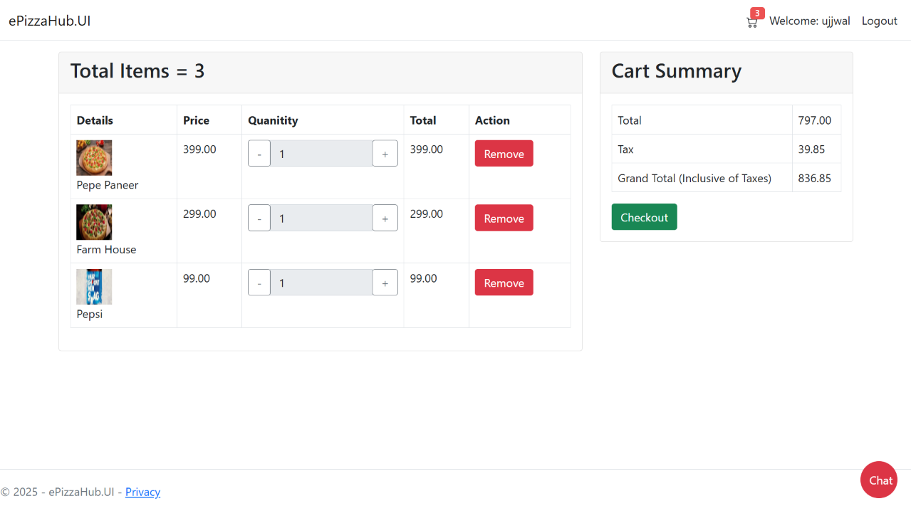